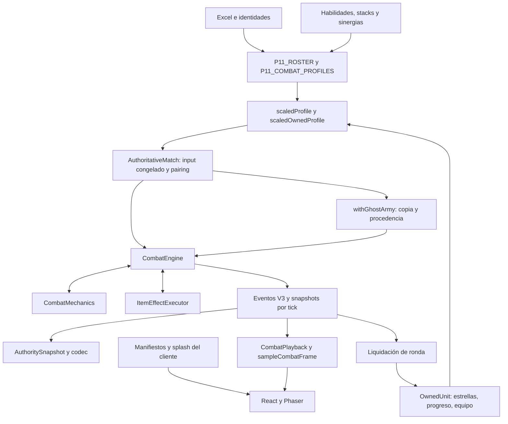

# F0-P13A — Auditoría de arquitectura de personajes

Fecha: 30/10/2026. Estado: análisis y diseño, sin refactorización ejecutada.

## 1. Base, alcance y evidencia

Base inmutable: F0-P12J, `d38f18bb8e0c4279c9ac92883942200225f0cb94`, rama `release/p12j-public-safe`. Se inspeccionaron HEAD, árbol limpio, ramas y worktrees locales; se creó desde ese SHA el worktree `p13a-champion-audit` y la rama `codex/f0-p13a-champion-architecture-audit`. La release y los worktrees de origen quedan intactos. No se consultaron ni modificaron proveedores remotos.

Esta auditoría describe **el código de esa base**, no las versiones iniciales de P6 ni el comportamiento de TFT. «Observado» significa verificado en fuentes o mediante lectura local de contratos; «propuesto» identifica trabajo futuro de P13B. No se han implementado handlers nuevos, cambiado habilidades ni inventado diseños para los 30 provisionales.

Documentos complementarios:

- [Arquitectura y contratos propuestos](CHAMPION_ABILITY_ARCHITECTURE.md).
- [Migración y gates de equivalencia](P13B_MIGRATION_PLAN.md).

## 2. Estructura real: varias capas, no un archivo por personaje

| Responsabilidad                             | Fuentes actuales                                                                                                                                                                                          | Naturaleza                                                                                           |
| ------------------------------------------- | --------------------------------------------------------------------------------------------------------------------------------------------------------------------------------------------------------- | ---------------------------------------------------------------------------------------------------- |
| Identidad y afinidades del Excel            | [roster-source.ts](../packages/game-data/src/roster-source.ts#L1), `roster-excel-source.json`                                                                                                             | Datos importados; 34 identidades, matriz de afinidades                                               |
| Registro histórico de cuatro completos      | [roster.ts](../packages/game-data/src/roster.ts#L6), [roster.ts compartido](../packages/shared/src/roster.ts#L14)                                                                                         | Construcción declarativa validada; 4 playable + 30 draft, no es el catálogo de 34 de P12J            |
| Catálogo jugable actual                     | [p11-roster.ts](../packages/game-data/src/p11-roster.ts#L12), `p11-provisional.json`                                                                                                                      | Ensambla 4 perfiles existentes + 30 parámetros individuales; provisionales sin activa/pasiva         |
| Costes, roles de simulación y sprite ID     | [legacy-rosters.ts](../packages/game-data/src/legacy-rosters.ts#L45), `p11-roster.ts`                                                                                                                     | Datos versionados; roles vanguard/striker/ranger/support/assassin                                    |
| Estadísticas base y compatibilidad          | [combat.ts](../packages/game-data/src/combat.ts#L137)                                                                                                                                                     | Objetos de perfiles y constructores de input por versión, no ejecución de combate                    |
| DOLEA                                       | [legacy-traits.ts](../packages/game-data/src/legacy-traits.ts#L2)                                                                                                                                         | Definición `ChampionAbility`, junto a sinergias antiguas; no existe `dolea.ts` dedicado en game-data |
| VARGAS                                      | [vargas.ts](../packages/game-data/src/vargas.ts#L32)                                                                                                                                                      | Habilidad, stacks, UPM y Depredador; helpers locales construyen datos                                |
| JARAMILLO                                   | [jaramillo.ts](../packages/game-data/src/jaramillo.ts#L2)                                                                                                                                                 | Habilidad, definición de progreso de partida y FUMÓN                                                 |
| FLORIN                                      | [florin.ts](../packages/game-data/src/florin.ts#L3)                                                                                                                                                       | Tuning, activa/pasiva, perfil y tres sinergias                                                       |
| Afinidades actuales y umbrales              | [roster-traits.ts](../packages/game-data/src/roster-traits.ts#L35), [p11-traits.ts](../packages/game-data/src/p11-traits.ts#L4)                                                                           | Migración explícita de recompensas históricas, escalones pendientes y disponibilidad                 |
| Rol descriptivo y daño principal            | [character-presentation.ts](../packages/game-data/src/character-presentation.ts#L32)                                                                                                                      | Metadatos descriptivos; 30 pendientes, sin alterar el simulador                                      |
| Rol para objetos                            | [scaledOwnedProfile](../packages/game-core/src/match/selectors.ts#L167), [política de objetos](../packages/game-data/src/items-tft185.ts#L449)                                                            | Asignación independiente: DOLEA tank, VARGAS assassin, JARAMILLO caster, FLORIN fighter              |
| Escalado/objetos/progreso antes del combate | [selectors.ts](../packages/game-core/src/match/selectors.ts#L52)                                                                                                                                          | Lógica ejecutable: crea perfiles nuevos y aplica capas en orden                                      |
| Resolución por tick                         | [CombatEngine](../packages/game-core/src/combat/engine.ts#L58)                                                                                                                                            | Dueño mutable exclusivo del estado, cola de señales, efectos, daño, acciones y eventos               |
| Mecánicas compuestas                        | [CombatMechanics](../packages/game-core/src/combat/mechanics.ts#L75)                                                                                                                                      | Stacks, atribución de bajas, repetición, salto, periódicos y ausencia/retorno                        |
| Objetos en combate                          | [ItemEffectExecutor](../packages/game-core/src/combat/item-effects.ts#L40)                                                                                                                                | Runtime separado conectado al mismo daño/curación/estados del motor                                  |
| Progreso entre rondas                       | [progress.ts](../packages/game-core/src/match/progress.ts#L3)                                                                                                                                             | Liquidación competitiva, fusión máxima e idempotencia por ronda                                      |
| Autoridad, clones y recuperación            | [AuthoritativeMatch](../apps/server/src/AuthoritativeMatch.ts#L111), [DurableMatch](../apps/server/src/persistence/DurableMatch.ts#L7)                                                                    | Ensambla duelos, persiste y publica solo estado confirmado                                           |
| Assets y animación                          | [characterAssets.ts](../apps/web/src/game/characterAssets.ts#L1), [sprite contract](../packages/sprite-contract/src/character.ts#L43), [splashArtCatalog.ts](../apps/web/src/game/splashArtCatalog.ts#L1) | Manifiestos/URLs/fallbacks de cliente; no reglas de daño                                             |

Los helpers `heal`, `speed`, `rule` de VARGAS y `modifier` de FLORIN son **factorías de definiciones**, no motores paralelos. La inicialización de módulos sí ejecuta validación Zod y ensamblado de catálogos. No confundir «declarativo» con «archivo JSON» ni con ausencia total de código de construcción.

### 2.1 Catálogo actual y estado de los 34

La lectura local de `P11_ROSTER` y `P11_COMBAT_PROFILES` confirmó 34 unidades: cuatro con `championAbility` y treinta `provisional: true`, sin activa/pasiva legacy ni principal. Todos conservan las afinidades del Excel. Los IDs son los actuales; no se asigna ninguna habilidad futura.

| ID                | Nombre          | Coste | Rol de simulación | Estado                    | Afinidades actuales                                                 |
| ----------------- | --------------- | ----: | ----------------- | ------------------------- | ------------------------------------------------------------------- |
| `dolea`           | DOLEA           |     2 | vanguard          | Completo existente        | gym, ruman_trinity, upm, hortaleza, fantasy                         |
| `vargas`          | VARGAS          |     3 | assassin          | Completo existente        | upm, pardillo, fantasy, pancho, valo, el-depredador                 |
| `florin`          | FLORIN          |     3 | striker           | Completo existente        | gym, ruman_trinity, perdidos_por_el_mundo, mano_de_obra             |
| `jaramillo`       | JARAMILLO       |     2 | ranger            | Completo existente        | fumon, upm, hortaleza, perdidos_por_el_mundo, pancho, valo, psoe    |
| `cosmin`          | Cosmin          |     1 | vanguard          | Provisional sin habilidad | fumon, ruman_trinity, hortaleza, fantasy                            |
| `agus`            | Agus            |     2 | vanguard          | Provisional sin habilidad | fumon, gym, upm, rata, fantasy, perdidos_por_el_mundo, valo         |
| `alfredo-pocho`   | Alfredo Pocho   |     3 | vanguard          | Provisional sin habilidad | fumon, upm, hortaleza, rata, psoe                                   |
| `peibol`          | Peibol          |     1 | striker           | Provisional sin habilidad | gym, upm, rata, fantasy, perdidos_por_el_mundo, valo, lenceria, jew |
| `emanuel`         | Emanuel         |     2 | striker           | Provisional sin habilidad | gym, hortaleza, rata, fantasy, pancho, psoe                         |
| `pablo`           | Pablo           |     3 | striker           | Provisional sin habilidad | fumon, fantasy, perdidos_por_el_mundo, lenceria                     |
| `manuel`          | Manuel          |     1 | ranger            | Provisional sin habilidad | fumon, hortaleza, pancho                                            |
| `henller`         | Henller         |     2 | ranger            | Provisional sin habilidad | hortaleza, pancho, valo                                             |
| `cayetana`        | Cayetana        |     3 | ranger            | Provisional sin habilidad | perdidos_por_el_mundo, valo, psoe                                   |
| `alex`            | Alex            |     1 | vanguard          | Provisional sin habilidad | fumon, hortaleza                                                    |
| `alvaro`          | Alvaro          |     2 | vanguard          | Provisional sin habilidad | hortaleza, valo                                                     |
| `danigm`          | DaniGM          |     3 | vanguard          | Provisional sin habilidad | fumon, hortaleza, fantasy, valo, psoe, todo-al-rojo                 |
| `titi`            | Titi            |     1 | striker           | Provisional sin habilidad | fumon, gym, hortaleza, fantasy, pancho, valo                        |
| `alfredo`         | Alfredo         |     2 | striker           | Provisional sin habilidad | fumon, hortaleza                                                    |
| `elena`           | Elena           |     3 | striker           | Provisional sin habilidad | perdidos_por_el_mundo, pancho, valo                                 |
| `jd`              | JD              |     1 | ranger            | Provisional sin habilidad | upm, perdidos_por_el_mundo, pancho                                  |
| `isaac`           | Isaac           |     2 | ranger            | Provisional sin habilidad | gym, pancho                                                         |
| `carlos-castillo` | Carlos Castillo |     3 | ranger            | Provisional sin habilidad | upm, shisheros                                                      |
| `jota`            | Jota            |     1 | vanguard          | Provisional sin habilidad | upm, shisheros                                                      |
| `rachel`          | Rachel          |     2 | vanguard          | Provisional sin habilidad | upm, psoe                                                           |
| `edu`             | Edu             |     3 | vanguard          | Provisional sin habilidad | upm, rata, perdidos_por_el_mundo, psoe                              |
| `sanchez`         | Sanchez         |     1 | striker           | Provisional sin habilidad | upm, pardillo                                                       |
| `focho`           | Focho           |     2 | striker           | Provisional sin habilidad | pardillo, blackhaus, shisheros                                      |
| `ruben`           | Ruben           |     3 | striker           | Provisional sin habilidad | fumon, gym, upm, pardillo, valo, blackhaus, shisheros               |
| `puto-alex`       | Puto Alex       |     1 | ranger            | Provisional sin habilidad | pardillo, rata, blackhaus, shisheros                                |
| `jaime`           | Jaime           |     2 | ranger            | Provisional sin habilidad | fumon, gym, pardillo, blackhaus, shisheros                          |
| `dani-silvestre`  | Dani Silvestre  |     3 | ranger            | Provisional sin habilidad | fumon, pardillo, blackhaus                                          |
| `miramon`         | Miramon         |     1 | vanguard          | Provisional sin habilidad | pardillo, blackhaus, shisheros                                      |
| `diego-lopez`     | Diego Lopez     |     2 | vanguard          | Provisional sin habilidad | pardillo, blackhaus, shisheros                                      |
| `domingo`         | Domingo         |     3 | vanguard          | Provisional sin habilidad | pardillo, shisheros                                                 |

«Completo existente» no es actualmente un estado formal versionado de validación. `CharacterRecord.status` pertenece al registro histórico, y `UnitDefinition.provisional` identifica los parámetros temporales actuales. La propuesta separa estado de autoría, implementación y validación sin sustituir esos contratos persistidos.

### 2.2 Estadísticas de los cuatro completos a 1★

Sin objetos, sin afinidades activadas ni progreso ganado:

| Unidad    |  HP |  AD |  AP | Armadura / RM | Ataques/s | Alcance | Crítico / multiplicador | Maná inicial/máximo |
| --------- | --: | --: | --: | ------------- | --------: | ------: | ----------------------- | ------------------- |
| DOLEA     | 600 |  40 |   0 | 45 / 35       |       0,8 |       1 | 0 % / 150 %             | 0/70                |
| VARGAS    | 700 |  70 |   0 | 25 / 25       |       0,8 |       1 | 20 % / 150 %            | 0/70                |
| JARAMILLO | 550 |  48 |   0 | 20 / 20       |      0,75 |       3 | 10 % / 150 %            | 0/70                |
| FLORIN    | 620 |  55 |   0 | 25 / 25       |       0,7 |       1 | 10 % / 150 %            | 0/80                |

`scaledProfile` aplica `[1000,1800,3240]` a HP/AD y solo a efectos principales marcados `starScaling: 'stat'`; `effectAmount` resuelve otros valores por estrella y AD/AP efectivos. `scaledOwnedProfile` aplica después Kilómetros y prepara equipo. `prepareTraitProfiles` prepara modificadores iniciales de objetos y afinidades. **Los tres roles no son intercambiables**: JARAMILLO es ranger en simulación, tirador físico en presentación y caster en la política de objetos existente. Uniformarlos cambiaría efectos de objetos.

## 3. Mapa de dependencias y recorrido compartido

Las flechas representan llamadas/importaciones o flujos comprobados en las fuentes citadas; no un orden total de ejecución. `game-core` usa contratos de `shared` y datos de `game-data`; no importa React ni Phaser. La autoridad simula el combate completo mediante `runCombat` y guarda el replay; la reproducción del cliente muestrea historia, no vuelve a decidir daño ni targeting.

### 3.1 Orden que debe conservarse

[Inicialización](../packages/game-core/src/combat/engine.ts#L159): parsear input y ordenar IDs → preparar perfiles/afinidades → construir estado y mecánicas → ajustar HP efectivo → crear ejecutor de objetos → emitir `combat_start` → iniciar objetos → eventos de afinidad y efectos iniciales → pasivas iniciales/muertes → fin si procede.

[Tick](../packages/game-core/src/combat/engine.ts#L889): incrementar tick/reiniciar orden; el tick terminal 450 solo comprueba fin. Overtime empieza en 300 antes de otros eventos. Expirar stacks y estados → cargar ataques → curación/retornos → tick de objetos → periódicos → pasivas/muertes → llegadas de movimiento y auras → recoger impactos/casts/releases comprometidos → resolver lote → estabilizar → llegadas de saltos → repeticiones → fin → decisiones nuevas en orden de IDs rotado → actualización final de auras/pasivas/muertes.

[Orden dentro del lote](../packages/game-core/src/combat/engine.ts#L386): efectos de apoyo con prioridad 0; daño con prioridad 1; `timing: 'after_damage'` con prioridad 2. Empate: índice original del lote. Se captura un conjunto de elegibles al inicio. La curación ligada a daño se difiere y vacía antes de prioridad 2 o al terminar el lote. No sustituir este comportamiento por ejecutar cada array de efectos de izquierda a derecha.

## 4. DOLEA: recorrido completo

1. **Definición.** `DOLEA_ABILITY`, ID `volumen-sucio`, mixed, en `legacy-traits.ts:2`; perfil en `combat.ts:149`. Coste 2, vanguard; las afinidades actuales vienen del Excel, no de la lista antigua Llama de Pádel.
2. **Evento/condición de pasiva.** El daño que reduce HP encola `hp_crossed`; `flushPassives` exige HP anterior ≥50 % y HP actual <50 % de HP máximo efectivo, unidad presente, activaciones <1. No es «estar bajo 50 % en cualquier tick» ni se activa por daño absorbido íntegramente.
3. **Efecto.** Escudo 12 % del máximo efectivo, redondeo del mecanismo común, duración de definición 450 ticks. Como el combate termina en 450, el plazo normalmente llega hasta su final; no es una duración nula persistente. Se aplica reducción de escudo de overtime y límite de capas del motor.
4. **Activa.** 70 maná, cast de 3 ticks, requiere enemigo adyacente; daño físico en radio 1 centrado en DOLEA: 100/180/324 por escalado estadístico. No escala con AP ni con AD efectivo. Armadura +20 por 40 ticks, clave `press-armor`, refresh sin acumular; el apoyo se aplica antes del daño por la prioridad del lote. Objetivo muerto, fuera de rango, stun o muerte pueden cancelar el cast según la ruta común.
5. **Estado.** `passiveState['volumen-eterno']` cuenta/seen/lastTick; `statuses` contiene escudo y armadura. Nuevo motor por combate reinicia esos campos. `effectCounter` participa en IDs; no regenerarlos de otra forma.
6. **Replay.** `damage`, `passive_trigger`, `shield_apply`, `status_apply`, `status_expire`, `ability_cast`, cancelaciones y snapshots completos. No añadir eventos nuevos para una mera extracción.
7. **Persistencia.** `OwnedUnit` no guarda esos estados entre rondas; los guarda el replay del duelo dentro de la autoridad para reanudar su reproducción. Ningún progreso persistente propio de DOLEA.
8. **Presentación.** Manifiesto `dolea`, sprites por estrellas/fallback, `unitAnimationCue`, feedback de pasiva/escudo, splash propio. Los sprites no deciden cuándo el golpe aplica daño.

**Compartible:** umbral, regla de una activación, escudo, área, refresh, escalado. **Específico:** definición y valores; no necesita handler nuevo.

## 5. VARGAS: recorrido completo

1. **Definición.** `VARGAS_ABILITY` (`copita-perhaps`) y `VARGAS_MECHANICS` en `vargas.ts:32/83`; perfil en `combat.ts:245`. Coste 3, assassin. UPM y El Depredador son afinidades; no fusionar su runtime con la pasiva del campeón.
2. **Evento/condición.** Un básico confirmado llama `CombatMechanics.confirm` con `attackId` deduplicado y señal `attack_hit`; un lanzamiento cancelado no cuenta. Un impacto íntegramente absorbido sí puede confirmarse. `allowSourceProcs` controla proc de origen. La pasiva `resaca-hit` añade un stack manualmente; `automatic: false` evita doble incremento.
3. **Efecto/estado Resaca.** +40 milésimas de velocidad relativa a base por stack, máximo 5, sin caducidad temporal y reset de combate. `gain` cruza umbral, emite ganancia/umbral, consume cinco **antes** de ejecutar cura del 5 % HP máximo y +20 % velocidad durante 30 ticks. Se puede comenzar otro ciclo mientras ese buff sigue activo; refresh por `resaca-speed`. `syncStack` reconstruye sus modificadores desde el contador.
4. **Activa Blackhaus RPP.** 70 maná, 3 ticks, objetivo actual, **impacto directo**, 280/420/700 % AD efectivo, no crítico según `canCrit: false` bajo reglas P11H. Cura 15/20/30 % de pérdida real de HP del objetivo, excluyendo escudo y overkill; cura común afectada por heridas/overtime. Luego buff `blackhaus-speed`: +25/35/50 % durante 30/40/50 ticks, prioridad after_damage. VARGAS no declara proyectil de activa; los proyectiles básicos solo existirían si el perfil tuviera alcance >1.
5. **El Depredador.** `lethalDamage`/`settleDeaths` atribuyen una baja y disparan `kill` si el responsable sigue vivo y permite cadenas. Stack depredador +5 AD/baja; a cuatro, +15 una vez; cura base 5 %, extra desde tercera; salto+básico inmediato desde séptima, reserva de casilla y presupuesto de cadena. Las condiciones de reglas se evalúan al recopilar tareas, antes del incremento: mínimos 2 y 6 consultan el contador previo. Mantener ese punto de lectura, no sustituirlo por ≥3/≥7 tras ejecutar la primera regla.
6. **Replay.** `attack_confirmed`, `stack_gain/threshold/consume`, `passive_trigger`, curas/estados, atribución de bajas, `jump_start/end`, `chain_attack`, límites y snapshots; acciones con causalId, profundidad, maná/procs y flags adicionales.
7. **Persistencia.** Resaca, Depredador y buffs son de combate, no se acumulan en `OwnedUnit.progress`. Replays guardan contadores/estados; IDs y flags causales deben coincidir también al restituir autoridad y clonar ejércitos.
8. **Presentación.** Manifiesto `vargas`, variantes por estrella, efectos de salto/ritmo y splash. El panel usa datos de escalado, no calcula otra fórmula de daño.

**Compartible:** confirmación, stack cíclico, curación derivada de daño y salto ya existen. **Específico:** composición de reglas y las claves de Resaca/Depredador; no convertir bajas en un contador de afinidad ni el salto en teletransporte inmediato.

## 6. JARAMILLO: recorrido completo

1. **Definición.** `JARAMILLO_ABILITY` (`cortina-de-humo`), `KILOMETRES` y FUMÓN en `jaramillo.ts:2/12/70`. Coste 2, ranger, alcance 3; rol descriptivo tirador físico y rol de objetos caster heredado.
2. **Pasiva fuera del tick.** `matchProgress` se procesa en [awardRoundProgress](../packages/game-core/src/match/progress.ts#L27), después de liquidar ronda. Exige elegibilidad de autoridad, no desarrollo, victoria south tras perspectiva y pertenecer al input congelado. No es una señal de kill ni un evento por tick.
3. **Progreso.** +1 Kilómetro, máximo 8; cada uno +3 % AD. `OwnedUnit.progress.stacks` guarda id/count/lastRound; este último evita duplicación. [Fusión](../packages/game-core/src/match/progress.ts#L8) retiene máximo de contadores y último round, no suma. [scaledOwnedProfile](../packages/game-core/src/match/selectors.ts#L182) aplica el bonus una sola vez después de estrellas. Se elimina al acabar partida.
4. **Activa.** 70 maná, 3 ticks; lanzamiento de proyectil compuesto al resolver cast. Se fijan importes a partir de estadísticas efectivas **al lanzamiento**, no al impacto: daño físico 160/240/400 % AD y reducción de armadura 15/20/30 % por 40 ticks after_damage. Vuelo `max(2, ceil(distancia*2/3))`. El proyectil no hace daño si su objetivo ya no está presente. La ruta de impacto no exige explícitamente fuente viva, aunque sí impide actuar si la fuente está ausente por recovery: conservar y probar esa distinción.
5. **Humo y afinidades.** FUMÓN utiliza ataque confirmado y reducción común: igual intensidad refresca, distinta intensidad coexiste, selector toma la mayor, no suma. En catálogo actual los escalones implementados son **2 y 4**, por migración desde 2 y 3; la regla de dos tiene máximo de 3 miembros. Con 4 se añade daño 60 % AD una vez por objetivo, clave global actual `fumon-first-smoke`. Otros escalones permanecen pendientes. JARAMILLO tiene también UPM y las demás afinidades de la matriz actual; no usar sus listas P6 como autoridad.
6. **Replay.** `ability_cast`, `projectile_launch` con efectos fijos, `damage.projectileId`, reducción/expiración y snapshots. El progreso de victoria está en la liquidación y estado de partida: no inventar un evento V3 de combate que hoy no existe.
7. **Clones/persistencia.** En políticas antiguas `progressionEligible=false` excluye fantasmas. Desde P12B/P12J, [AuthoritativeMatch.settle](../apps/server/src/AuthoritativeMatch.ts#L651) permite al **jugador real** ganar Kilómetros por su victoria contra clon; el dueño del clon solo cobra su propio duelo. [p12b.test.ts](../apps/server/src/p12b.test.ts#L156) lo fija. El texto «no cuentan victorias contra fantasmas» de la definición es anterior y no describe la política vigente. El clon contiene AD ya progresado en una copia congelada; no comparte ni actualiza el ledger persistente del dueño.
8. **Presentación.** Manifiesto compuesto `jaramillo`, body/release/recovery, proyectil e impacto propios; `compositeBody`/`compositeFlight` muestrean tiempos del servidor. Splash Erik se resuelve como JARAMILLO por equivalencia ya documentada, sin renombrar ID.

**Compartible:** vuelo, daño, reducción, escalado y deduplicación. **Específico:** adaptador de liquidación de victoria/fusión y composición visual. No trasladar la progresión al motor de combate ni reintroducir la exclusión histórica de clones en P12J.

## 7. FLORIN: recorrido completo

1. **Definición.** `FLORIN_TUNING`, `FLORIN_ABILITY` (`pisoton-carmesi`) y `FLORIN_PROFILE`, `florin.ts:3/55/306`. Coste 3, striker, luchador físico/verdadero descriptivo. El nombre de activa depende de estrellas: Pisotón Carmesí / Pisotón Demoledor / ¡A Picar Piedra!, no una habilidad distinta por nombre.
2. **Pasiva de ciclo.** `attackCycle` tiene arrays por estrella. [basicAttackPower](../packages/game-core/src/combat/engine.ts#L835) prepara el golpe 6.º/5.º/4.º tras 5/4/3 ataques con bonus 50/60/75 % AD. [damage](../packages/game-core/src/combat/engine.ts#L714) incrementa `mechanics.basicAttacks` y emite `suela-reforzada`; a 3★ ralentiza movimiento 20 % por 10 ticks. El contador interno es acumulativo con módulo; la descripción «reinicia» es conceptual, no asignación a cero.
3. **Activa.** Maná 80, cast 4 ticks. Primario 180/260/400 % AD, secundarios radio 1/2/3, excluyendo primario, con 90/156/300 % AD (equivalen a 50/60/75 % de los coeficientes principales). Stun primario 10/15/20 ticks; buff de velocidad 0/10/20 % durante 1/30/40 ticks. Aunque el texto diga «gana después», stun y modifier no llevan after_damage y el lote los resuelve antes del daño. No «corregirlo» al extraer.
4. **Mano de Obra.** Es una sinergia única de reglas, no la pasiva Suela. Primera salida: `hp_crossed` 60 %, etapa completada 0. Segunda: `damage_received` y HP <30 %, etapa completada 1. No son dos umbrales idénticos. Cada salida maxActivations 1; recovery exige etapa exactamente anterior+1 y unidad no ausente.
5. **Ausencia y retorno.** [apply recovery](../packages/game-core/src/combat/mechanics.ts#L380) guarda stage/away/nextHealTick/onReturn, cancela acción y emite `unit_presence`. `isAlive` incluye ausentes; `isPresent` no. No atacan, no reciben daño; cada 10 ticks curan 8 % HP máximo por la misma tubería de heridas/overtime. [recoveries](../packages/game-core/src/combat/mechanics.ts#L596) retorna al curarse o ser último aliado vivo, elige casilla libre por distancia/r/q. Primera vuelta +25 % velocidad de ataque y +15 % movimiento, sin caducidad durante combate; segunda cambia básicos a verdadero. No hay tiempo fijo de regreso.
6. **Replay.** Contadores, damage, stun/buff, `unit_presence`, curas, cancelaciones, casilla elegida, tipo verdadero y snapshots. `moveRemainder` conserva aritmética de velocidad. Ausentes cuentan para decidir victoria y no se debe cerrar prematuramente el duelo.
7. **Persistencia.** Suela y etapas de recovery reinician al crear otro combate. Estado de ausencia y cola de retorno sí forman parte de los snapshots guardados del replay. No persistir como progreso entre rondas ni en Auth.
8. **Presentación.** `recoveryVisual` se basa en presencia ya emitida; salida 450 ms y retorno 400 ms (modo reducido 120 ms). Esos tiempos **no son ticks de ausencia lógica**. `CombatRenderer` muestra indicador de recuperación y dirige opacidad/posición; el retorno real lo decide el motor. El texto de marcador `FLORIN` es específico de presentación actual y no debe propagarse a una primitiva genérica.

**Compartible:** ciclo parametrizado, modificadores, área, targeting y recuperación como capacidad del motor. **Específico:** la máquina de estados de presencia y su integración exacta con fases; necesita adaptador tipado, no una expresión JSON arbitraria.

## 8. Duplicaciones verificadas y límites de extracción

Las siguientes son repeticiones observadas, no conclusiones por similitud de nombre. Riesgo incluye orden, identidades de efectos y compatibilidad.

| Sitios y funciones                                                                       | Responsabilidad común                                                 | Diferencia semántica que conservar                                                                                      | Decisión / riesgo                                                                                      |
| ---------------------------------------------------------------------------------------- | --------------------------------------------------------------------- | ----------------------------------------------------------------------------------------------------------------------- | ------------------------------------------------------------------------------------------------------ |
| `engine.ts:1013–1029` y `1081–1098`, construcción de proyectil básico/activa             | ID, from/to, launch/impactTick y fórmula de vuelo repetidos           | Básico fija rawDamage al decidir; activa fija arrays de efectos al lanzar; metadata critical/cause/attackId distinta    | Constructor interno de DTO con parámetros explícitos; medio                                            |
| `engine.ts:846–866` y `1168–1180`, ataques inmediato/normal                              | Sorteo de varianza, AD efectivo, potencia de ciclo y crítico          | Ataque normal tiene windup/charge; inmediato emite chain_attack y su orden RNG/cause es distinto                        | Extraer solo cálculo común puro, no planificación; alto por RNG                                        |
| `engine.ts:557–612` y `item-effects.ts:202–233`, creación/refresco de estado             | Buscar viejo, expirar, crear ID, insertar y emitir                    | Marker de objeto stat:null/group/procedencia y no-op si idéntico; efecto general tiene maxHP/shield/stun y cancelación  | Constructor de registro de estado limitado, sin unificar políticas aún; alto                           |
| `engine.ts:528–553` y `math.ts:84–92`, Humo                                              | Grupo y clave de reducción de armadura aparecen en productor/selector | Uno aplica/refresca; otro selecciona máximo sobre defensa positiva                                                      | No son dos implementaciones equivalentes; conservar productor y selector                               |
| `mechanics.ts:255–276` y `engine.ts:598–604`, ajuste HP al cambiar máximo                | Conservar delta de HP efectivo acotado a [1,max]                      | syncStack reemplaza todos sus modifiers sin eventos status_apply; efecto general emite y tiene captura de máximo previa | Helper aritmético puro candidato; medio, no unificar eventos                                           |
| `vargas.ts:8–31`, `florin.ts:44–54`, builders de cura/modifier/regla                     | Repetición de literales con self/radius/key/refresh                   | Duración finita/nula, stat y límites distintos                                                                          | Factorías de autoría opcionales que produzcan el mismo objeto y orden de claves; bajo/medio por hashes |
| `mechanics.ts:741`, `item-effects.ts:160` y `pathfinding.ts:55`, candidatos de objetivos | Filtrar equipo/presencia y desempatar                                 | Búsqueda de camino/rango, distancia+ID, untargetable y salto no son la misma política                                   | Reutilizar compareIds/hexDistance/isPresent; no sustituir por selectTargets universal; alto            |
| `mechanics.ts:648` y `item-effects.ts:758`, periódicos                                   | Tick siguiente y caducidad de tareas                                  | Periódico de campeón fija importe; burn de objeto recalcula % HP y atribución; distinto orden de fases                  | Mantener runtimes; posible aritmética de plazo pura, no scheduler nuevo; alto                          |
| `combat.ts:245/288/331/354` y `p11-roster.ts:12/33`                                      | Identidad/perfil/afinidades ensamblados en capas                      | Es también historia congelada, no duplicación eliminable sin versión                                                    | Vista de autoría actual; preservar exports y versiones viejas; alto                                    |
| `abilities.ts:32` de game-data y UI de escalados                                         | Resumen de habilidad a partir de definición                           | Presentación legacy genera texto; motor calcula con estado efectivo, objetos y ticks                                    | Reusar datos, no ejecutar descripciones ni fórmulas UI como autoridad                                  |

**Ya centralizado; no duplicar:** `CombatEngine.damage` converge daño directo, proyectiles, periódicos y objetos; `resolveEffects` cura y crea escudos/estados; `effectAmount`, `effectiveStat`, `criticalRoll`, `abilityConditions`, `analyzeTraits`, `progressDefinition/awardRoundProgress/mergeUnitProgress` ya sirven a varios personajes. `ItemEffectExecutor.heal` delega en host.effect: no es otro algoritmo de curación. La absorción de escudos está centralizada en damage; no extraer una versión por campeón.

## 9. Qué se persiste realmente

| Dato                                                                                             | Entre rondas                      | Guardado de autoridad / replay                                        | Solo interno o presentación         |
| ------------------------------------------------------------------------------------------------ | --------------------------------- | --------------------------------------------------------------------- | ----------------------------------- |
| OwnedUnit.id/definitionId/stars/location/equipment                                               | Sí                                | MatchState dentro de players                                          | No                                  |
| OwnedUnit.progress: version/stacks/id/count/lastRound                                            | Sí, hasta fin de partida          | Sí                                                                    | No                                  |
| Perfil de combate resuelto, traits, mechanics declarativas y itemLoadout                         | Input congelado del duelo         | Sí                                                                    | No                                  |
| HP/maná/charge/action/target/death/statuses                                                      | No como próxima unidad económica  | CombatState en snapshots del replay                                   | No                                  |
| basicAttacks, recovery, moveRemainder, stacks, casts/kills, periodics                            | Se reinician en siguiente combate | UnitMechanics en snapshots                                            | No                                  |
| receivedEffects, passiveState y firedThresholds                                                  | No                                | Sí, en CombatUnit/StackState                                          | No                                  |
| rngState, effectCounter, proyectiles, pendingRepeats y atribuciones                              | No como economía                  | Sí en CombatState/replay                                              | No                                  |
| Cola `triggers`, Map lethal, Set confirmed, índices traitEntries/counters, presupuestos por tick | No                                | **No**                                                                | Internos de una ejecución exclusiva |
| ItemCombatRuntime: sequence, entries/counts/last/chosen, contributors y settled                  | No entre combates                 | Sí, `CombatState.items`                                               | No                                  |
| requestId/sequence/receipts/revision, settlementId y completedDuels                              | Sí según contrato                 | AuthoritySnapshot                                                     | No                                  |
| Sprites cargados, texturas, selección, cámara, reloj de playback                                 | No alteran lógica                 | No en estado de campeón; arena tiene contrato propio de lobby/partida | Cliente                             |

Referencias: [OwnedUnit](../packages/shared/src/match.ts#L15), [CombatUnit/Projectile/State](../packages/shared/src/combat.ts#L559), [UnitMechanics](../packages/shared/src/mechanics.ts#L112), [AuthoritySnapshot](../apps/server/src/persistence/snapshot.ts#L255), [codec](../apps/server/src/persistence/codec.ts#L36).

El motor actual **no expone restauración desde un CombatState arbitrario a mitad del tick**. `runCombat` calcula replay completo y la autoridad restaura duelos/receipts/reloj guardados. Suponer que basta serializar las nuevas clases/handlers perdería confirmed/lethal/triggers. P13B conserva este modelo; una API de pausa/reanudación del simulador requeriría otra especificación.

`DurableMatch.run` usa cola de un escritor y copy-on-write; solo cambia la instancia publicada después del commit. Reintento ambiguo reutiliza documento/commitId. La recuperación de personajes debe mantenerse dentro de ese límite, sin side effects en handlers ni nueva escritura SQL.

## 10. Riesgos y decisiones derivadas

1. **Muy alto: orden y RNG.** Cambiar la posición de un emit/root, el consumo de effectCounter, un floor, el orden de candidatos o la consulta de un contador modifica eventos y replays aunque gane el mismo equipo.
2. **Alto: historia.** Hay reglas/catálogos distintos, no una única definición viva. Cambiar builders compartidos puede cambiar fingerprints o perfiles de partidas antiguas. La huella no cubre todo el código ejecutable: igualdad de hash es necesaria pero insuficiente.
3. **Alto: interacción ítems.** Mantener roles independientes, flags de proc, heridas, crítico prohibido en P11H, accounting, máximos y overtime. No unificar ItemEffectExecutor con pasivas en P13B.
4. **Alto: FLORIN.** isAlive ≠ isPresent; ausencia no es muerte ni stun; auras, proyectiles, camino, victoria y dos disparadores diferentes dependen de ello.
5. **Medio: registro.** El registro histórico 4/30 draft no define el catálogo actual; un nuevo registry debe conservar ambas vistas y no eliminar provisionales jugables.
6. **Medio: textos.** La descripción antigua de JARAMILLO excluye clones, pero P12B vigente autoriza progreso del jugador real. «Después» en texto no garantiza orden de effects. No corregir textos/balance en una extracción silenciosa.
7. **Medio: estado de validación.** No existe un sello tipado de personaje validado. Proponerlo como metadata de autoría/revisión, sin añadir campos al snapshot actual.

## 11. Método y validación de esta fase

Lectura directa, búsquedas de símbolos y comprobación local de esquemas. Se generó además un grafo AST local de 196 archivos de código, sin enviar el repositorio a servicios LLM ni procesar secretos: extracción 1636 nodos/4924 aristas, coste de extracción semántica 0 tokens. Se consultaron los nodos CombatEngine/CombatMechanics/ItemEffectExecutor/AuthoritativeMatch/scaledProfile/effectAmount y se contrastó el recorrido en las líneas originales.

**Limitación del grafo:** el diagnóstico detectó 903 aristas con extremos no presentes, 9 autorreferencias y 91 relaciones que colapsan al reducir a DiGraph. La materialización añadió nodos de referencia (2038 nodos/4831 aristas); no es un mapa completo ni prueba de ausencia de dependencias. Se conservaron las relaciones crudas y el diagnóstico en `artifacts/p13a/graphify-out`. El diagrama y conclusiones de este informe se basan en fuentes verificadas, no en inferir significado de esas aristas incompletas. Los hubs observados incluyen ItemEffectExecutor, AuthoritativeMatch, CombatMechanics y effectiveStat; esto orienta navegación, no justifica abstracciones por sí solo.

Comprobaciones ligeras del entregable: lectura local del catálogo (34/4/30), parseo de perfiles reales, contratos TypeScript de ejemplos, referencias de archivo/línea/símbolo, igualdad de fuentes ejecutables y fingerprints respecto a P12J, diff documental y árbol Git. Se reutiliza la evidencia del gate P12J (1849 pruebas más campañas y lifecycle); **no se presenta como suite repetida en P13A**. No se ejecutó la suite extensa ni se cambió código funcional.

Resultado de lectura: 19 fingerprints de autoridad en snapshot.ts; 18 contrastados además con el registro histórico acreditado en P12J y la huella actual P12F contrastada contra el mismo baseline. Los valores completos están en el anexo siguiente y no se deben regenerar sustituyendo históricos.

### 11.1 Fingerprints conservados

| Constante                    | SHA-256                                                            |
| ---------------------------- | ------------------------------------------------------------------ |
| `CATALOG`                    | `6ea00046ac77e4b6d6a6da066fa9f7de2f3d79b921bb68c451820430e1773814` |
| `COMPOSITE_CATALOG`          | `9d7856e10295c0b9a8385215d4727c0c024c6830f7eb73df5aee192103437365` |
| `DROP_ITEM_CATALOG_HASH`     | `d4df4a0d295e1222d3239933419f8a87012141ffc4545fcb113b00f6096291cf` |
| `EFFECT_ITEM_CATALOG_HASH`   | `8107c0053d8c6445ad25607ab14cea7c6fe296a1271dbe2223819b8d9f9a3e5a` |
| `FLORIN_CATALOG_HASH`        | `3844748d2c84597e79f8e80883754a33b77dec1b7247109b2b747d422baa9499` |
| `INTEGRATED_CATALOG_HASH`    | `9e6339d7b3493ad4f0751c50de7da0a9a8e3e9f89fcbbf759c3d3fb26109a975` |
| `ITEM_CATALOG_HASH`          | `3b28bee386abbbcf4ad39ebb9ea23bf0d7ea8dd0123686ec32d4290f37374e93` |
| `P11B_CATALOG_HASH`          | `d2c3309ae90ff3a62420ee2a58825cd12bc99fd66cfbf00fae959ade9d4848ea` |
| `P11C_CATALOG_HASH`          | `f030371fbd8e8d9dd9cb20e9ecac35d4740965d12487bc04ff563f4909bef027` |
| `P11G_CATALOG_HASH`          | `0dfbe33e1f8edf9c43297ab913261fce17ce89ee760a23968ca0ea500b9ae9a4` |
| `P11H_CATALOG_HASH`          | `94149eed99622635dd2694c0358cab0deaa7daff2895bd4311ca8bfb773a1c5b` |
| `P11K_CATALOG_HASH`          | `edd6bc4f87fba4e9d4724706c0e66c02cdf97a39a50884cf5f339aa3caf9e23e` |
| `P11_CATALOG_HASH`           | `dcb65ed6e6269b5891b993741324beda2aab96dfecf0785937de2be883453972` |
| `P12B_CATALOG_HASH`          | `0948310d6132a43cf03607ab356c12120357473863ff75c87cdde6fe7b45e72f` |
| `P12D_CATALOG_HASH`          | `f72149712af1870e65b35765e34b7c063b947e2f96cd469412fb68d8219bc02f` |
| `P12F_CATALOG_HASH`          | `2efe29720393226ccefb0c26f74ebcbb3f2733cc8b0a8e6cba7e831e5fb40adc` |
| `ROSTER_CATALOG_HASH`        | `9e0b5ff3ed81c653c8cc05ae2cfa72b50b9f8d7fc5d53850d37f07daeb5510f0` |
| `STANDARD_ITEM_CATALOG_HASH` | `082b6bdf5fb3d91865720fa0b919fd3222347d92e8ad96f8e52b532c24267d72` |
| `TFT_POOL_CATALOG_HASH`      | `df0ae8961f1a3eb18797d8ce71c195834d1ac85b14d583f5b2a9a5e0325fc83e` |

Los scripts, copias de código del grafo y resultados ligeros de validación quedan ignorados bajo `artifacts/p13a`; no son cambios de producción. El commit de P13A contiene exclusivamente los tres documentos. Railway, Supabase y GitHub no se utilizaron en esta fase. P13B queda pendiente de un encargo posterior.
