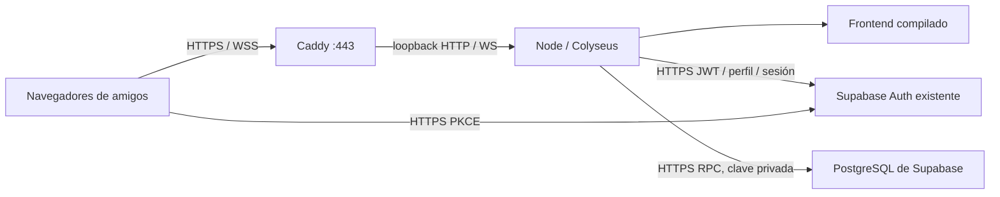

# F0-P9A — Arquitectura remota privada

Base verificada: `10fbc9b113ea6cd9f0cc54d417c8cc4458892316`, cierre P8F. Rama aislada `codex/f0-p9a-remote-infrastructure`. Baseline fresco: 1.307 pruebas/88 archivos, PostgreSQL incluido, 99,02 s. No se alteran reglas, objetos, catálogos, temporizadores competitivos, HUD ni splash arts.

## Elección: B, un origen y un proceso

El backend escucha exclusivamente en loopback. Caddy termina TLS, redirige HTTP y sustituye las cabeceras de proxy. Una instancia Node sirve los archivos compilados y todas las salas. Se conserva Supabase Auth y el adaptador durable existente; no se inventa un `DATABASE_URL` remoto ni se cambia a un segundo almacén. No se usan cookies propias del juego: Supabase JS conserva su sesión en el almacenamiento del navegador y envía JWT; login/recuperación mantienen PKCE.

| Criterio | A: estático + servicio persistente separados | B: mismo origen, recomendado |
| --- | --- | --- |
| Simplicidad | Dos releases, dos URLs y dos proveedores posibles | Una release, una URL, un proxy |
| CORS / sesiones | Allowlist cruzada explícita; sin cookies de juego | Mismo origen; allowlist exacta defensiva |
| Colyseus | Requiere servicio permanente que acepte Upgrade | Proceso permanente y proxy WSS |
| Persistencia | Supabase externo, idéntico contrato | Supabase externo, idéntico contrato |
| Coste | Hosting estático posiblemente gratuito + cómputo siempre activo | VM pequeña + Supabase existente |
| Mantenimiento | Plataforma puede gestionar TLS; coordinación de releases | Administrar SO, Node, Caddy y servicio |
| Disponibilidad | CDN mantiene portal si cae servidor | Web y juego comparten caída; Auth/DB externos |
| Escalabilidad mínima | CDN separa carga estática | Suficiente para ensayo supervisado; medir antes de ampliar |
| Recuperación | Reiniciar instancia única, mismas revisiones y catálogo | Reiniciar instancia única, mismas revisiones y catálogo |

B reduce puntos de fallo y errores de configuración para 2–4 participantes. No garantiza disponibilidad continua. Un servicio que duerma por inactividad no es adecuado. No se propone balanceador, Redis, Kubernetes ni varios procesos Node. Dos procesos con las mismas partidas no están soportados: el CAS detectaría conflictos pero no coordina propiedad distribuida.

## Preparado en código

- `remote/config.ts`: validación cerrada por entorno, nombres reales y ausencia de valores secretos en errores.
- `remote/runtime.ts`: restauración antes de escuchar, autenticación, métricas numéricas y apagado.
- `remote/http.ts`: guardia anterior al router de Colyseus, Host, Origin, proxy, CORS, límites, estáticos y disponibilidad.
- `network/endpoint.ts`: mismo origen en cliente desplegado, rechazo de contenido mixto incluso con destino loopback.
- `infra/remote/`: ejemplos, proxy y servicio systemd. No se instalan ni activan remotamente.
- `scripts/remote/`: CA local, proxy TLS de diagnóstico, confianza limitada al perfil Chrome de prueba.

El servidor real solo importa el verificador Supabase. La entrada de diagnóstico separada utiliza JWT HMAC de vida corta para cuatro UUID ficticios y valida una base local desechable específica. Ninguna ruta del laboratorio se registra en `main.ts`.

Estado final, pruebas y límites: [VALIDATION](VALIDATION.md), [operación](REMOTE_OPERATIONS.md), [entornos](REMOTE_ENVIRONMENT.md).

## F0-P9A.1 — Memoria y retención

La autoridad sigue siendo un único proceso. F0-P9A.1 añade retención final configurable y evita checkpoints en finales confirmados; no cambia el modelo de despliegue ni habilita diagnóstico remoto.

[Perfil de memoria](SERVER_MEMORY_PROFILE.md) · [Política de retención](MATCH_RETENTION_POLICY.md) · [Mediciones y validación](SERVER_PERFORMANCE_BASELINE.md).

## F0-P9B-R0 — Railway Hobby

Railway sustituye Caddy por su edge gestionado en el proveedor elegido: un Node en 0.0.0.0:PORT sirve frontend y Colyseus. El contrato loopback anterior permanece para VPS. La concesión SQL y commits con propietario impiden doble autoridad; no se permiten rolling deploys sin una parada controlada.

[Despliegue](RAILWAY_DEPLOYMENT.md) · [Variables](RAILWAY_ENVIRONMENT.md) · [Operación](RAILWAY_OPERATIONS.md) · [Preflight](RAILWAY_PREFLIGHT.md).
